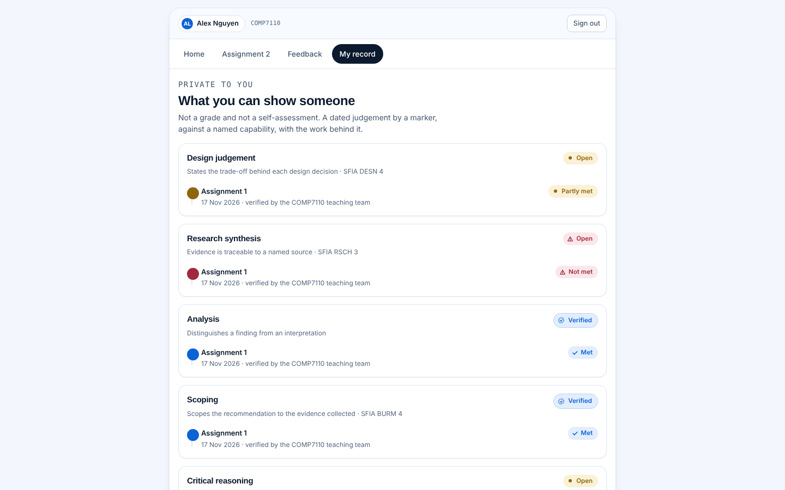
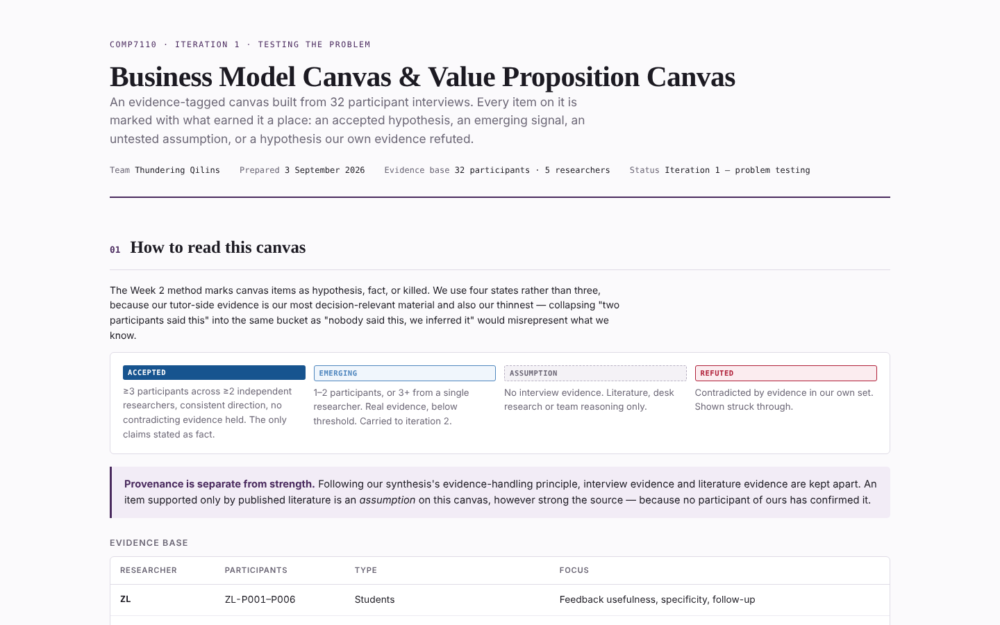
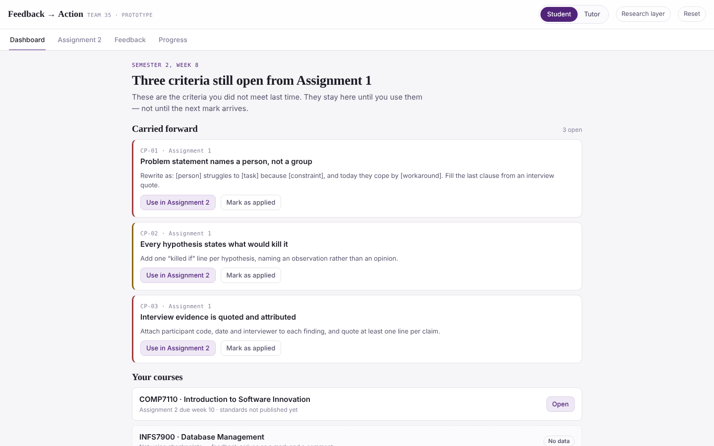
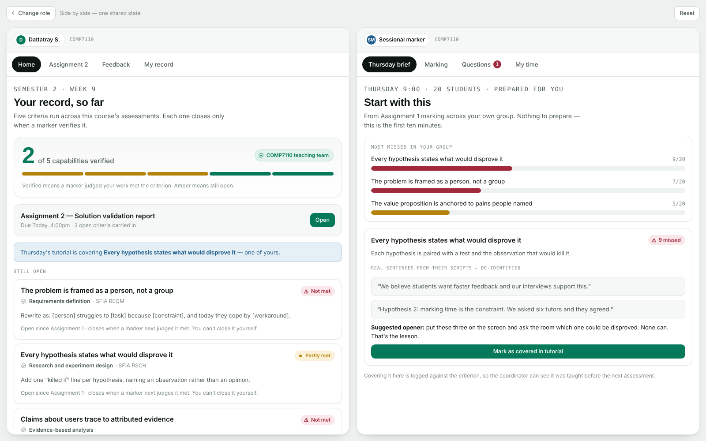
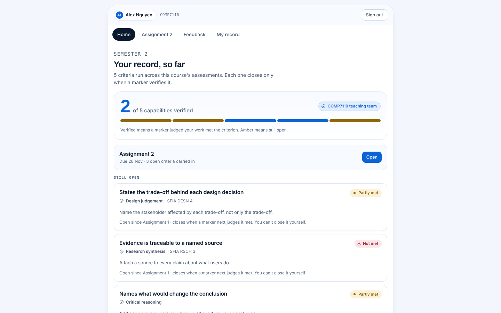
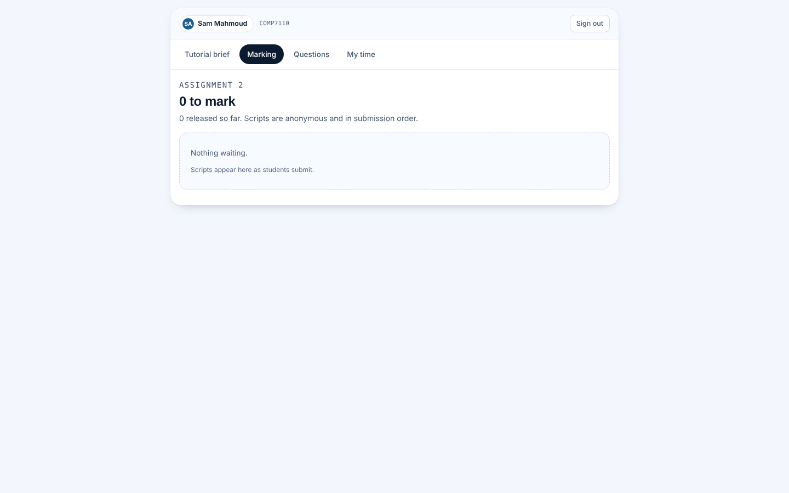
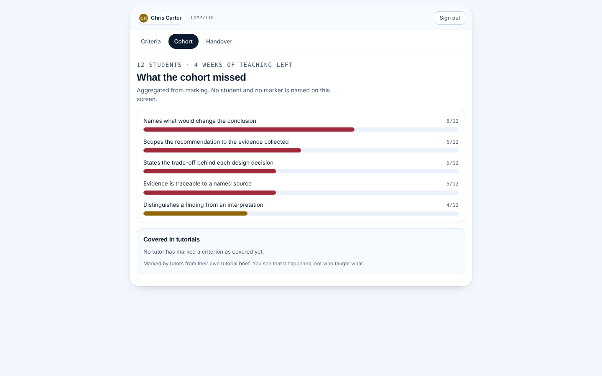

# Proofolio: feedback that becomes evidence

**A web app that turns a marker's judgement into a dated, verified record of what a student can do, carried into their next assignment and, eventually, to employers.**

Team project (5 members) · COMP7110 Introduction to Software Innovation · The University of Queensland · Semester 2, 2026
My role: research lead on the business model, prototype designer and builder, and one of two MVP developers

## The problem

At a large university course, feedback breaks down at both ends:

- **For students,** marks often arrive after the next assignment has started, and comments are short because sessional tutors are paid by the minute. In our interviews, students said feedback "disappears once the next assignment starts".
- **For teaching teams,** what a tutor notices while marking never reaches the coordinator or next semester's tutors, because most sessional staff don't return.

AI has made explaining feedback free and instant. What is now scarce is something AI can't produce: a qualified person's dated judgement of what a student actually did. Aligned to UN SDG 4, Quality Education.

## The process: three iterations

| Iteration | Focus | What happened |
|---|---|---|
| 1 | Testing the problem | 32 interviews by 5 researchers (students, tutors, an alumnus) turned into an evidence-tagged Business Model Canvas |
| 2 | Testing the solution | Clickable prototypes and usability tests, then critique from a tutor mentor and the course coordinator led to a pivot |
| 3 | Building the MVP | A working Django app covering the full loop: publish criteria, submit, mark, release, ask, build the record, hand over |

## What I did

**Research and business model**
- Ran the SDG 4 topic research: a five-option shortlist scored on access, evidence, crowding, buildability and ethics, plus a scan of six problem areas and around 30 competitors
- Wrote the direction brief the team chose, with four testable hypotheses backed by nine sources
- Conducted five student interviews as part of the team's 32
- Built the full Business Model Canvas and Value Proposition Canvas. I introduced a four-state evidence rule (Accepted, Emerging, Assumption, Refuted) in place of the course's three states, so thin evidence was never presented as fact

**Requirements and prototyping**
- Graded the team's 10 proposed requirements and found that five were really five views of one object: the marking criterion. That became the core value proposition. I cut four requirements, each with reasons
- Wrote the iteration 2 prototype plan: an eight-screen test flow at three fidelity levels
- Built the "Feedback to Action" prototype. Several teammates built prototypes, and mine matched the agreed requirements most closely, so the team used it for group testing
- Ran usability interviews with my own interview guide

**The pivot**

Testing showed "explain my feedback" was too thin, since ChatGPT already does it. But both of my test participants asked, unprompted, for a university-verified record of their skills for graduate jobs. I reframed the product around that: an attested capability record. I defined a four-role model (student as user, coordinator as champion, tutor as gatekeeper, faculty as buyer) and built prototype v2 around it.

**Building the MVP**

The team chose me and one teammate as the two developers. I built the templates, styling and copy for every screen, the student views, seed data, documentation and the demo script. My teammate built the data models, tutor and coordinator views, access control tests and deployment. For the course requirement that every member commits code, I wrote a setup guide that split the finished app into five parts, one per member.

- Django 5 and SQLite, 9 database tables, 18 pages, role-based access for three roles
- Accessibility tested with axe-core: 0 WCAG 2.0 and 2.1 AA violations across all 18 pages, and all 21 colour contrast pairs pass
- Checked at 320px width and 200% zoom, plus keyboard checks. Testing found four bugs, all fixed

| Student dashboard | Tutor marking queue | Coordinator cohort view |
|---|---|---|
|  |  |  |

## Repository guide

| Folder | Contents |
|---|---|
| [`app/`](app/) | The Proofolio Django app. Start with [`START-HERE.md`](app/START-HERE.md) |
| [`prototypes/`](prototypes/) | Prototypes v1 and v2 and the pitch pages. Download and open in a browser |
| [`research/`](research/) | SDG 4 topic research and the two direction briefs |
| [`design/`](design/) | Business Model Canvas, competitive analysis, requirement verdicts and the v2 app flow |
| [`images/`](images/) | Screenshots of the prototypes and the running app |

Several research and design documents were drafted with an AI assistant (Claude) from my direction, decisions and interview data. Participant interviews are not published.

---

[Dattatray Siraskar](https://www.linkedin.com/in/dattatray-s-410359129) · Master of Interaction Design, The University of Queensland
